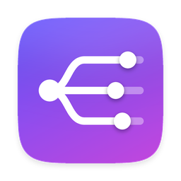

<p align="center">
  
</p>

<h1 align="center">Prisma</h1>

<p align="center">
  Volumen y salida de audio independientes para cada app de tu Mac.<br>
  Spotify por los altavoces, Discord por los auriculares. A la vez.
</p>

<p align="center"><i>English summary at the bottom.</i></p>

---

## Qué hace

macOS solo tiene un volumen y una salida de audio para todo el sistema.
**Prisma** vive en la barra de menús y te deja decidir, app por app:

- **Por dónde suena**: altavoces del Mac, auriculares, AirPods, el monitor por HDMI/DisplayPort…
  o **en varios a la vez** (por ejemplo, altavoces y AirPods con el mismo audio),
  con un **volumen propio para cada dispositivo**.
- **A qué volumen**, sin tocar el del resto de apps.
- **Silenciarla** con un clic.

Los ajustes se guardan por app. Si eliges unos AirPods y los desconectas, esa app vuelve
a la salida del sistema y regresa a los AirPods cuando se reconectan.

Una app que está al 100 % y en «Salida del sistema» no se toca: suena exactamente igual que sin Prisma.

## Cómo funciona

Usa los *process taps* de Core Audio (macOS 14.2+), sin drivers de audio virtuales:

1. Un **tap** intercepta el audio de la app y lo silencia en su salida original.
2. Un **dispositivo agregado privado** une ese tap con los dispositivos que elijas. Si son varios,
   uno marca el reloj (mejor uno con cable o integrado) y los demás llevan compensación de deriva.
3. Un callback en tiempo real copia el audio a la salida aplicando el volumen (con una pequeña rampa para evitar chasquidos).

Las apps que reproducen desde procesos auxiliares (Safari, Chrome…) se agrupan bajo su app principal.

## Instalación

Requiere **macOS 26** o posterior, en Apple Silicon o Intel.

### Opción A: descargar la app

1. Descarga el `.zip` de la última versión en [Releases](../../releases).
2. Descomprímelo y arrastra **Prisma** a **Aplicaciones**.
3. Ábrela. Como la app no está firmada con una cuenta de desarrollador de Apple,
   macOS la bloqueará la primera vez:
   - Ve a **Ajustes del Sistema → Privacidad y seguridad** y pulsa **Abrir igualmente**, o
   - en Terminal: `xattr -dr com.apple.quarantine /Applications/Prisma.app`

### Opción B: compilar desde el código

Necesitas Xcode 26 o sus herramientas de línea de comandos (`xcode-select --install`).

```bash
git clone https://github.com/amaestra205/prisma.git
cd prisma
./build.command
```

La app se compila, se instala en Aplicaciones y se abre sola.

### Primer arranque

La primera vez que cambies el volumen o la salida de una app, macOS pedirá permiso para
**grabar audio del sistema**. Es necesario para poder tocar el audio de otras apps;
el audio nunca se graba ni sale de tu Mac. Puedes revisarlo en
*Ajustes del Sistema → Privacidad y seguridad → Grabación de audio*.

Desde el panel puedes activar **Abrir al iniciar sesión**.

## Uso

Haz clic en el icono de Prisma en la barra de menús (un punto que se abre en tres deslizadores). Verás las apps que están sonando
(o han sonado hace poco) con:

- un menú para elegir el dispositivo de salida (puedes marcar varios),
- un control de volumen y un botón de silencio,
- una flecha para volver a dejarla como estaba.

Si tienes muchos iconos y no ves el de Prisma (puede quedar tapado por el notch), abre Prisma
otra vez desde Aplicaciones o Spotlight y se mostrará el panel.

### Diagnóstico

```bash
PRISMA_DEBUG=1 /Applications/Prisma.app/Contents/MacOS/Prisma
```

## Licencia

MIT.

---

### English summary

Prisma is a macOS menu bar app that gives every app its own volume and output device — or several
devices at once, each with its own level — using Core Audio process taps (no virtual audio driver).
Requires macOS 26. Download it from Releases or build it with `./build.command`.
